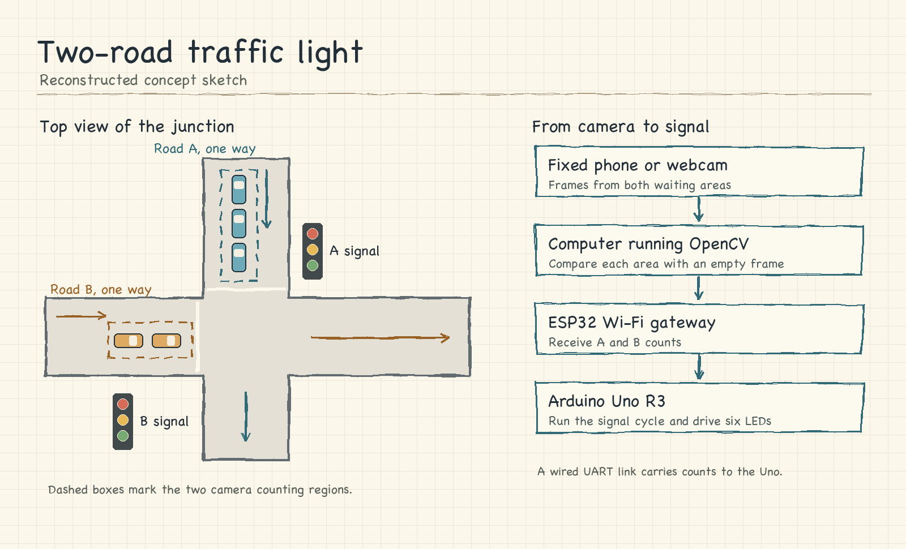
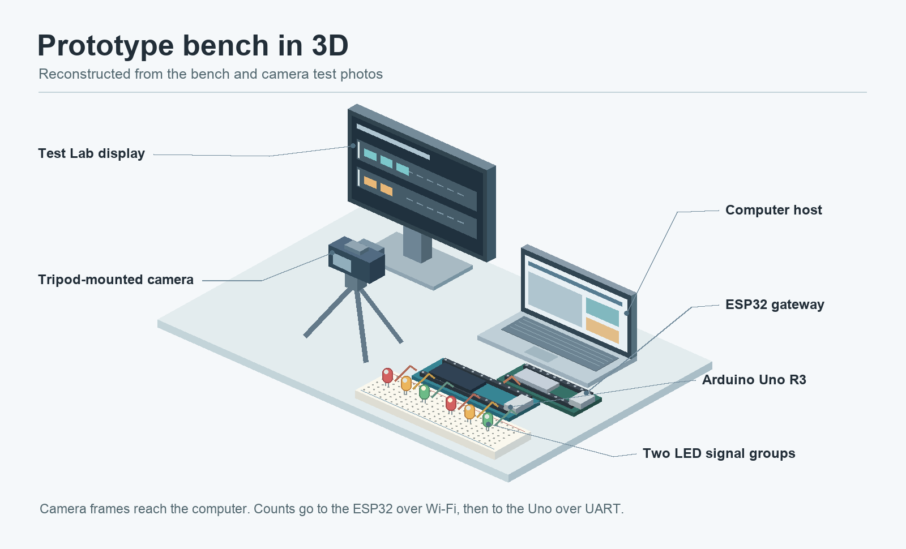

# INT4089 Smart Traffic Light Development Log

Code development period **2–20 November 2026** · All times are Hong Kong time (UTC+8).

This classroom prototype controls two crossing one-way roads. A camera supplies video to a computer, which estimates the number of model cars waiting on each road. An ESP32 forwards the counts to an Arduino Uno R3. The Uno drives two sets of red, yellow and green LEDs and extends the next green for the busier road. The dated bench and development notes record observations from the prototype sessions. [Project README][project]

## 1. Prototype Design and Justification (15%) · 原型設計與論證

### How the idea developed

The starting question was how a phone camera could help two roads share green time when their queues were different. The first proposal separated the system into three steps. Cycle the LEDs, send two known counts, then measure the counts with a camera. The design used two crossing one-way roads with one signal group per road. Six LEDs made each phase visible on a breadboard and kept the wiring manageable for a classroom demonstration. Initial prototype notes, 18 Nov.

### Alternatives considered

| Decision | Options explored | Reason for the final choice |
| --- | --- | --- |
| Signal timing | A fixed cycle, or a cycle that adjusts green time to the difference in queue lengths | Adaptive timing shows the effect of unequal demand. The fixed cycle remains the baseline and resumes when counts expire. |
| Where counts come from | Enter A and B manually, or count cars from camera frames | Manual entry isolates the controller and UART during bench tests. Camera counting makes the demonstration respond to the scene and still allows manual input during calibration. |
| How a phone supplies video | An Android IP camera stream was discussed. An iPhone with Mac Continuity Camera was prototyped. The browser host was then developed. | The browser host keeps OpenCV processing on the computer and supports a computer camera or a phone browser over trusted HTTPS. This avoids tying the packaged app to a single desktop OS. |
| How to reach the ESP32 | Join the board's own Wi-Fi hotspot, use the board's IP address on a router, or discover the board on the shared network | USB Wi-Fi setup and mDNS discovery reduce setup steps. The released launcher retains manual IP entry for networks where discovery is unavailable. |

Initial prototype notes, 18 Nov. · Browser and bench development notes, 19 Nov. · [Browser camera guide][camera-guide]

### Final design and key features

- **Bounded adaptive timing.** Each road starts with a 10-second green. The busier road gets 2 additional seconds per extra car, up to 20 seconds total. Yellow lasts 3 seconds and each all-red interval lasts 2 seconds. The Uno applies a change at the next green phase and returns to the fixed cycle after five seconds without a valid count. [Controller logic][controller]
- **Counting with an ordinary camera.** The operator selects two waiting areas and captures an empty background. The OpenCV detector compares the current image with that baseline in each area and counts separated foreground objects. The phone can serve as the camera while the computer does the processing. [Detector source][detector] · [Calibration guide][camera-guide]
- **Separate control and networking.** The Uno owns the signal cycle. The ESP32 handles Wi-Fi, serves a manual control page and forwards counts over UART. The optional Uno State panel queries the Uno for the active phase, time remaining and fresh counts using a level-shifted return channel. [Hardware and API guide][project] · [Uno State release notes][release-120]
- **Repeatable classroom demonstrations.** The Traffic Light Test Lab makes it possible to set known queues, watch the countdown and compare the dashboard's counts with the test scene. A bench tester can use manual counts to verify a specific green duration before introducing the camera. [Test Lab guide][test-lab]

### Prototype hand-drawn-style sketch · 原型手繪風格草圖

**Figure 1.** Retrospective digital sketch based on the initial design notes. The dashed boxes mark the two waiting areas. The signal heads represent the two groups of three LEDs. Initial prototype notes, 18 Nov.

## 2. Prototyping and Evaluation (15%) · 原型製作與評估

### Build and test timeline

| Date | Work completed and how it was checked |
| --- | --- |
| **18 Nov** | Built the two-board C++ prototype in PlatformIO. Connected six LEDs with separate 1 kΩ resistors. Verified each board's individual upload and used manual car counts to exercise the control page. Built the first Mac camera tool and published the project and English guides on GitHub. The controller test, eight Mac camera tests and both firmware builds passed during the initial publication. Initial prototype notes, 18 Nov. · PlatformIO upload notes, 18 Nov. · Initial release and test notes, 18 Nov. |
| **19 Nov, 00:47–02:53** | Added the browser camera dashboard, moved detection into the browser host and packaged Python and OpenCV for Windows x64, macOS Intel and Apple Silicon, and Linux x64 and ARM64. Published v1.0.0. Added the USB Wi-Fi wizard and same-network discovery, then published v1.1.0. Both firmware targets built, 22 browser-camera tests passed, and the five-platform CI run succeeded. Browser and bench development notes, 19 Nov. · [v1.0.0][release-100] · [v1.1.0][release-110] · [Five-platform CI][ci-110] |
| **19 Nov, 02:54–04:42** | Flashed the ESP32 and verified the written firmware digest. Used the USB wizard to join the router and confirmed that the dashboard automatically paired with the same board. Built the simulator, added a stopped-queue mode for calibration and checked one-way UART with known manual counts. Added the English ESP32 page and Uno State panel. Published the Test Lab and Uno State in v1.2.0. Browser and bench development notes, 19 Nov. · [v1.2.0][release-120] |
| **19 Nov, 04:57–05:31** | Translated the computer dashboard into English for v1.2.1. Built a Windows x64 installer and added its checksum to the release. Windows CI passed the install, dashboard startup and uninstall checks. Updated the English and Traditional Chinese guides with bench and camera-test photos and added an MIT license. [v1.2.1][release-121] · [Windows installer CI][ci-windows] · [Documentation update][docs-commit] |
| **20 Nov** | Added visible MIT license links to both README headers and made the repository public. [README update][license-commit] |

### 3D prototype model view · 原型 3D 模型圖

**Figure 2.** Simplified 3D model of the test arrangement, reconstructed from the bench photos. The monitor provides the known test queues, the tripod holds the camera steady, and the two LED groups sit on the breadboard. [Original bench photo][bench-photo] · [Original camera test photo][camera-photo]

### Evaluation results, challenges and modifications

| Test or issue | Result and change | Evidence |
| --- | --- | --- |
| Signal sequence and fallback | The C++ host test passed phase order, bounded green extension, stale data, command parsing and timer rollover. It checked that a new count leaves an active phase intact. | [Controller test][controller-test] · Initial release and test notes, 18 Nov. |
| ESP32 upload failure | PlatformIO reported no serial data until the ESP32 appeared on a USB serial port. Each board was uploaded separately and the two-target configuration was restored. The combined upload remained unverified in that troubleshooting session. | PlatformIO upload notes, 18 Nov. |
| Early iPhone camera access | OpenCV on the Mac reported a camera authorization failure with Continuity Camera. The later browser host provided camera permission controls and a trusted HTTPS route for phone browsers. Desktop and simulated mobile browser flows were exercised. The recorded checks leave live iPhone capture unverified. | Initial prototype notes, 18 Nov. · Browser and bench development notes, 19 Nov. |
| ESP32 setup and gateway discovery | The ESP32 saved its Wi-Fi settings over USB, rejoined the router and paired in the dashboard. The observed gateway identity matched the flashed device. | Browser and bench development notes, 19 Nov. · [v1.1.0][release-110] |
| Known camera counts | A controlled simulator run reported **A = 3, B = 2** across 24 frames. A small on-screen test image caused a missed count in a separate check. Stopped queues, an enlarged view, and a fixed camera made it easier to check the selected areas. The README records a camera view with the same 3/2 count. | Browser and bench development notes, 19 Nov. · [Camera counting result][project] |
| Manual counts to physical timing | With **A = 3, B = 1**, the Uno USB log showed `Phase=1 duration_ms=14000`. Road A's 14-second green matched the timing rule and confirmed the ESP32-to-Uno command path. | Browser and bench development notes, 19 Nov. |
| Camera to physical timing and Uno State | The dashboard could not reach the gateway during the live 3/2 camera-to-board attempt, leaving the expected 12-second Road A green unverified. The Uno State interface shipped later that morning. A physical return-channel check through the level shifter remained open in the recorded bench tests. | Browser and bench development notes, 19 Nov. · [v1.2.0 release notes][release-120] |
| Packaging and installation | Windows CI passed checksum verification, installer build, installation, dashboard startup and uninstall. The earlier browser-camera CI YAML parsing failure was fixed before the first release. | [Windows installer run][ci-windows] · [Workflow fix][workflow-commit] |

### How the prototype meets the user needs

The project can show that uneven queues affect a physical signal. With a two-car difference entered manually, the measured Road A green increased from the 10-second baseline to 14 seconds. Equal or stale counts return the controller to the baseline at the next green, and the phase sequence preserves the yellow and all-red intervals. The two-board arrangement also makes a communication fault easier to locate because the dashboard, ESP32 and Uno each provide a separate place to check the signal path. Browser and bench development notes, 19 Nov. · [Timing and manual test guide][project]

For repeatable classroom use, the operator can select known queues in the Test Lab, verify the camera count, and use manual entry to isolate the network and controller. USB Wi-Fi setup and automatic pairing were demonstrated on the physical ESP32. The available evidence covers controlled camera counting and one-way manual control on the bench. Live phone capture, camera-to-LED timing and physical Uno State return remained open checks. [Camera guide][camera-guide] · Browser and bench development notes, 19 Nov.

## Appendix · Repository history

The table lists all 14 commits on `main` during the 18–20 November development period. [Commit history][commits] · [Build and test logs][actions]

| Date and time | Commit | Change |
| --- | --- | --- |
| 18 Nov, 04:40 | [`5245eac`](https://github.com/JacksonChan762/INT4089_traffic-light/commit/5245eacd985a388ac6dff1f5bdacfbd576213c0d) | Published the project, source, tests and README. |
| 18 Nov, 04:53 | [`412b401`](https://github.com/JacksonChan762/INT4089_traffic-light/commit/412b401752e3cae8286fde146a08708138aacd4e) | Translated the project and Mac camera guides into English. |
| 19 Nov, 01:32 | [`5ed8791`](https://github.com/JacksonChan762/INT4089_traffic-light/commit/5ed8791e660f470ad1ef69ab5f0fa5aea1093a87) | Added the cross-platform browser camera and ESP32 Wi-Fi setup. |
| 19 Nov, 01:33 | [`e818ff0`][workflow-commit] | Fixed parsing of the browser camera CI workflow. |
| 19 Nov, 01:41 | [`c76548a`](https://github.com/JacksonChan762/INT4089_traffic-light/commit/c76548a64ccb37cba7dd767fb5916b0260f92a84) | Moved camera detection into the browser host. |
| 19 Nov, 01:49 | [`3a3ec1a`](https://github.com/JacksonChan762/INT4089_traffic-light/commit/3a3ec1a3e5f9bb31640504fe7a0b29ce31449f7a) | Documented release downloads and repaired the ESP32 example link. |
| 19 Nov, 02:51 | [`2337c42`](https://github.com/JacksonChan762/INT4089_traffic-light/commit/2337c42c159804163e3898dd666a83638b90ec05) | Added USB Wi-Fi onboarding and ESP32 auto-pairing. |
| 19 Nov, 04:37 | [`eb95eef`](https://github.com/JacksonChan762/INT4089_traffic-light/commit/eb95eef5e93c0a9521a5f0db0ff0eaf10b36f671) | Added the traffic simulator and live Uno state. |
| 19 Nov, 04:39 | [`5be4ead`](https://github.com/JacksonChan762/INT4089_traffic-light/commit/5be4eadaf91e724630da168f5b47f1ab9493c74a) | Updated the download guides for v1.2.0. |
| 19 Nov, 04:57 | [`23dc2b5`](https://github.com/JacksonChan762/INT4089_traffic-light/commit/23dc2b5fb6deda83c0ae8d6704a14623b31a939b) | Translated the browser camera dashboard into English. |
| 19 Nov, 05:13 | [`26c2c9a`](https://github.com/JacksonChan762/INT4089_traffic-light/commit/26c2c9a83eba975efbcfc7a169ee331dfe0b2c2a) | Built and tested the Windows camera app installer. |
| 19 Nov, 05:16 | [`96a6129`](https://github.com/JacksonChan762/INT4089_traffic-light/commit/96a6129bb6a256dc1fe95aeca4824e433cdf45b0) | Linked the Windows installer in the download guides. |
| 19 Nov, 05:31 | [`aac1b68`][docs-commit] | Rewrote the guides and added demo photos and the MIT license. |
| 20 Nov, 16:20 | [`f2852a5`][license-commit] | Added MIT license links to both README headers. |

### Published releases

| Release | Published | Main change |
| --- | --- | --- |
| [v1.0.0][release-100] | 19 Nov, 01:46 | Cross-platform browser camera packages with manual ESP32 address entry. |
| [v1.1.0][release-110] | 19 Nov, 02:53 | USB Wi-Fi setup and same-network gateway pairing. |
| [v1.2.0][release-120] | 19 Nov, 04:42 | Traffic Light Test Lab, English ESP32 control page and Uno State. |
| [v1.2.1][release-121] | 19 Nov, 04:59 | English computer dashboard. The Windows installer and its checksum were added later that morning. |

[project]: https://github.com/JacksonChan762/INT4089_traffic-light#readme
[controller]: https://github.com/JacksonChan762/INT4089_traffic-light/blob/main/arduino_uno/TrafficController.h
[controller-test]: https://github.com/JacksonChan762/INT4089_traffic-light/blob/main/tests/controller_test.cpp
[detector]: https://github.com/JacksonChan762/INT4089_traffic-light/blob/main/browser_camera/detector.py
[camera-guide]: https://github.com/JacksonChan762/INT4089_traffic-light/blob/main/browser_camera/README.md
[test-lab]: https://github.com/JacksonChan762/INT4089_traffic-light/blob/main/browser_camera/README.md#test-the-camera-with-cars-at-traffic-lights
[bench-photo]: https://github.com/JacksonChan762/INT4089_traffic-light/blob/main/img/arduino-uno-esp32-breadboard.jpg
[camera-photo]: https://github.com/JacksonChan762/INT4089_traffic-light/blob/main/img/camera-test-setup.jpg
[ci-110]: https://github.com/JacksonChan762/INT4089_traffic-light/actions/runs/44374330760
[ci-windows]: https://github.com/JacksonChan762/INT4089_traffic-light/actions/runs/44399174723
[actions]: https://github.com/JacksonChan762/INT4089_traffic-light/actions
[commits]: https://github.com/JacksonChan762/INT4089_traffic-light/commits/main/
[workflow-commit]: https://github.com/JacksonChan762/INT4089_traffic-light/commit/e818ff02ea1d0782b12668e7edc6deab902e482f
[docs-commit]: https://github.com/JacksonChan762/INT4089_traffic-light/commit/aac1b685f56395326815ef3c8b2a001f399ffd89
[license-commit]: https://github.com/JacksonChan762/INT4089_traffic-light/commit/f2852a59ada239ee521d938db0fa01c91e7e9364
[release-100]: https://github.com/JacksonChan762/INT4089_traffic-light/releases/tag/v1.0.0
[release-110]: https://github.com/JacksonChan762/INT4089_traffic-light/releases/tag/v1.1.0
[release-120]: https://github.com/JacksonChan762/INT4089_traffic-light/releases/tag/v1.2.0
[release-121]: https://github.com/JacksonChan762/INT4089_traffic-light/releases/tag/v1.2.1
