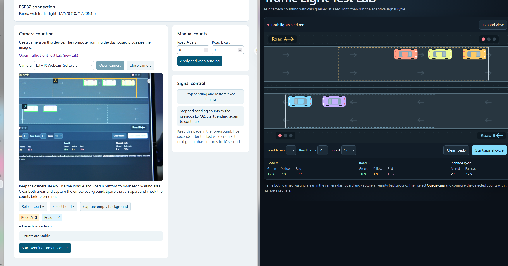
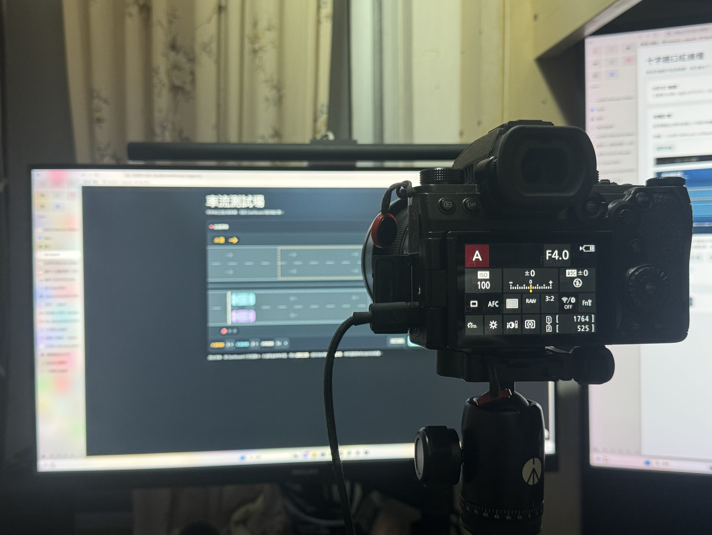
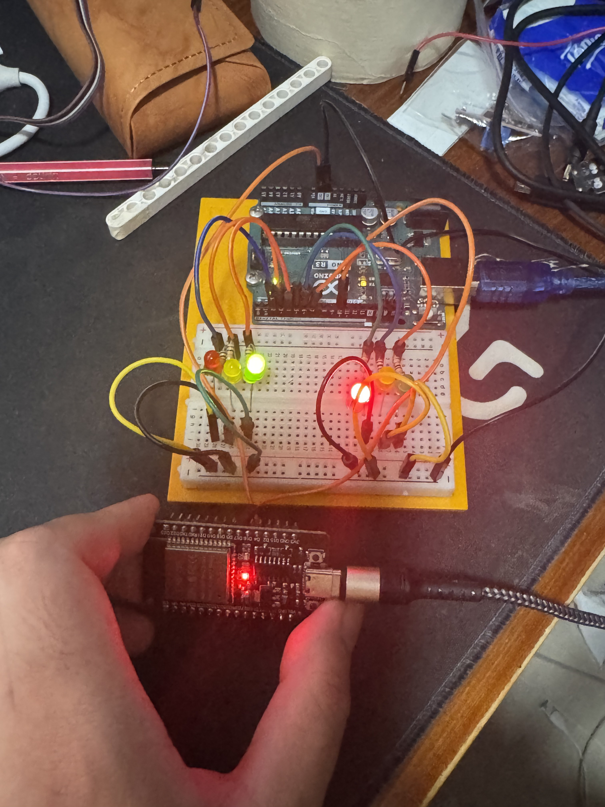

# INT4089 Smart Traffic Light

**English** · [繁體中文](README.zh-TW.md) · [MIT License](LICENSE) · [Development Log](DEVELOPMENT_LOG.md)

A classroom traffic-light model for two roads. The Arduino Uno R3 drives six LEDs. An ESP32 receives car counts over Wi‑Fi and forwards them to the Uno, which gives the busier road a longer green light. Enter counts by hand or use the browser dashboard to count model cars with a camera.



*Camera test with the two waiting areas selected. The dashboard reports three cars on Road A and two on Road B.*

## Download the browser camera app

Choose the build for your computer. The packages include Python and OpenCV. [GitHub Release v1.3.0](https://github.com/JacksonChan762/INT4089_traffic-light/releases/tag/v1.3.0)

| Platform | Download | Start the app |
| --- | --- | --- |
| Windows x64 | [Setup EXE](https://github.com/JacksonChan762/INT4089_traffic-light/releases/download/v1.3.0/TrafficLight-Camera-windows-x64-setup.exe) | Run the installer, then open **Traffic Light Camera** from the Start menu. |
| macOS Apple Silicon | [tar.gz](https://github.com/JacksonChan762/INT4089_traffic-light/releases/download/v1.3.0/TrafficLight-Camera-macos-apple-silicon.tar.gz) | Extract the archive and open `Start.command`. |
| macOS Intel | [tar.gz](https://github.com/JacksonChan762/INT4089_traffic-light/releases/download/v1.3.0/TrafficLight-Camera-macos-intel.tar.gz) | Extract the archive and open `Start.command`. |
| Linux x64 | [tar.gz](https://github.com/JacksonChan762/INT4089_traffic-light/releases/download/v1.3.0/TrafficLight-Camera-linux-x64.tar.gz) | Extract the archive and run `./start.sh` in that folder. |
| Linux ARM64 | [tar.gz](https://github.com/JacksonChan762/INT4089_traffic-light/releases/download/v1.3.0/TrafficLight-Camera-linux-arm64.tar.gz) | Extract the archive and run `./start.sh` in that folder. |

Verify downloads with the [Windows EXE SHA-256](https://github.com/JacksonChan762/INT4089_traffic-light/releases/download/v1.3.0/TrafficLight-Camera-windows-x64-setup.exe.sha256) or the [portable archive checksums](https://github.com/JacksonChan762/INT4089_traffic-light/releases/download/v1.3.0/SHA256SUMS.txt).

## Quick start

1. [Wire the six LEDs and the two boards](#hardware-and-wiring), then [build and upload both firmware targets](#build-and-upload).
2. Power the ESP32 and [set up Wi‑Fi from your phone](#set-up-wifi-from-a-phone).
3. To count cars with a camera, connect the computer to the same router and start the camera app. In **Traffic Light Dashboard**, open the camera or enter counts under **Manual counts**. The Uno applies a new duration when the next green phase starts.

## Set up Wi-Fi from a phone

1. Join the ESP32 hotspot **`TrafficLight-xxxxxx`** using the password **`Traffic4089`**. The hotspot starts when the ESP32 has no saved network or cannot connect for about 12 seconds. Stay connected if your phone reports that the hotspot has no internet.
2. Open [http://192.168.4.1](http://192.168.4.1) in your phone browser. Enter your router's **2.4 GHz** Wi-Fi name and password, then choose **Connect and save**. The ESP32 saves the settings after it connects and gets an IP address.
3. Switch your phone to the router's Wi-Fi and open the address shown on the setup page. The ESP32 reconnects to the saved network after power loss or a temporary outage. The setup hotspot closes about 30 seconds after the ESP32 reconnects.

For use without a router, stay on the ESP32 hotspot and choose **Open traffic light controls and phase log**. The ESP32 page supports manual counts and the log. Camera counting runs on the computer. [USB setup and camera guide](browser_camera/README.md#join-the-computers-network)

## Use the browser dashboard

Open **Camera counting** to use a built-in or USB camera on the computer. For an Android phone or iPhone camera, connect it to the same router and open the computer's dashboard over trusted HTTPS. The computer processes the frames in both cases. [Camera and phone setup](browser_camera/README.md)

1. Select **Open camera** and keep the camera fixed.
2. Choose **Select Road A** and **Select Road B**, then drag around each waiting area.
3. Clear both areas and choose **Capture empty background**. Put the cars back with space between them.
4. Wait until the counts are stable, then choose **Start sending camera counts**. Keep the page in the foreground while sending.

Use **Open Traffic Light Test Lab (new tab)** to test the camera against on-screen cars. The simulator shows the planned durations and a countdown when its signal cycle is running.

**Light timing log** shows the latest 60 completed phases, with the time each phase began since the Uno booted and how long it actually lasted. The ESP32 collects entries in the background, including while the dashboard is closed. The log is kept in memory and starts again when either board restarts. Use Camera App v1.3.0 or later, updated firmware on both boards, and the [two-way UART wiring](#add-a-uart-level-shifter-for-uno-state).



*Camera test setup. The tripod keeps the waiting areas in the same place in each frame.* [Dashboard overview](img/camera-dashboard.png)

## Hardware and wiring

Use an Arduino Uno R3, a classic ESP32-WROOM-32 development board with GPIO16 and GPIO17 available, six low-current LEDs, six 1 kΩ resistors, jumper wires and two USB cables. Check the specific pinout and PlatformIO board setting if using another ESP32 variant.



*The bench prototype with one red, yellow and green LED per road.*

Disconnect both USB power cables before wiring. For each LED, connect its Uno pin through its own **1 kΩ resistor** to the anode (long leg). Connect the cathode to GND.

| Road | Red | Yellow | Green |
| --- | --- | --- | --- |
| A | Uno D2 | Uno D3 | Uno D4 |
| B | Uno D5 | Uno D6 | Uno D7 |

For a basic one-way bench test, connect ESP32 **GPIO17 TX** to Uno **D10 RX** and connect **GND to GND**. The Uno disables the D10 pull-up. Power each board through its own USB cable and keep their supply rails separate. Leave Uno D11 and ESP32 GPIO16 open for one-way control.

### Add a UART level shifter for Uno State

Use a non-inverting level shifter with two channels for 3.3 V and 5 V push-pull UART. Remove the direct GPIO17-to-D10 wire before adding the shifter.

| Connection | Wiring |
| --- | --- |
| Forward channel | ESP32 **GPIO17 TX** → low-voltage side → high-voltage side → Uno **D10 RX** |
| Return channel | Uno **D11 TX** → high-voltage side → low-voltage side → ESP32 **GPIO16 RX** |
| Shifter supplies | ESP32 **3V3** → LV supply and Uno **5V** → HV supply |
| Common ground | ESP32, Uno and shifter **GND** to the same ground point |

Use separate channels for the two directions. Configure direction and enable pins according to the shifter's datasheet. Route the Uno's 5 V return signal through the shifter before connecting it to the ESP32.

## Build and upload

Install PlatformIO Core or the PlatformIO IDE extension. Run the commands from the folder containing `platformio.ini`.

```sh
pio run -e uno -e esp32
pio device list
pio run -e uno -t upload --upload-port UNO_PORT
pio run -e esp32 -t upload --upload-port ESP32_PORT
```

Replace `UNO_PORT` and `ESP32_PORT` with the corresponding ports from `pio device list`. Windows uses COM ports. Linux commonly uses `/dev/ttyUSB*` or `/dev/ttyACM*`, and macOS uses `/dev/cu.*`. Check that the LEDs cycle after uploading the Uno firmware.

[Uno firmware](arduino_uno) · [Timing logic](arduino_uno/TrafficController.h) · [ESP32 gateway firmware](esp32_gateway)

## Try the direct manual controls

1. Connect both boards and open the ESP32's `http://` address from a device on the same Wi‑Fi router. The ESP32 prints this address on its USB serial monitor at **115200 baud**. Enter `status` to display it again.
2. Set **Road A** to **3** and **Road B** to **1**, then choose **Apply and keep sending**. The plan shows **14 seconds** for the next A green and **10 seconds** for B. Keep the page in the foreground so it can send a count every second.
3. With both firmware targets updated and the return channel connected through a level shifter, choose **Check Uno state**. **Uno State** shows the phase reported by the Uno, its duration, remaining time and any fresh counts. With one-way wiring, check the phase from the Uno's USB serial monitor at **115200 baud**.
4. Choose **Restore fixed timing** when finished. The Uno also reverts to fixed timing after five seconds without a valid count.

Use either the dashboard or the ESP32 control page to send counts during a test.

## How the timing works

The cycle runs **A green → A yellow → both red → B green → B yellow → both red**. Yellow lasts **3 seconds** and each all-red interval lasts **2 seconds**.

Each green starts at **10 seconds**. The Uno adds **2 seconds** per extra car on the busier road, up to **20 seconds** total. Equal or expired counts give each road **10 seconds**. The active phase runs to completion when counts change.

## ESP32 HTTP API

| Request | Purpose |
| --- | --- |
| `GET /api/gateway` | Read the gateway identity used for pairing. |
| `POST /api/counts` | Send form data such as `ns=3&ew=1`. Both values are integers from 0 to 99. |
| `POST /api/auto` | Request fixed timing. |
| `GET /api/state` | Query the Uno for its active phase, duration, time remaining and fresh counts. Returns HTTP 503 when the Uno does not return a valid reply. |
| `GET /api/phase-log` | Read the completed phases captured by the ESP32, most recent first. Times are milliseconds measured by the Uno. |

The gateway sends `C,3,1` or `A` followed by a newline over its 9600 baud UART link. In the Uno response, phase values 0–5 follow the cycle starting with all red before A green.

## Verification

Build and run the host controller test with a C++11 compiler. [Browser camera tests](browser_camera/README.md#test-the-host-on-any-platform)

```sh
c++ -std=c++11 -Wall -Wextra -pedantic tests/controller_test.cpp -o /tmp/traffic-controller-test
/tmp/traffic-controller-test
```

On the bench, first verify that the Uno alternates both roads. Send A = 3 and B = 1 and verify that A's next green is 14 seconds. Stop sending, allow five seconds for the counts to expire and verify that the next green is 10 seconds.

## License

The project source and documentation are available under the [MIT License](LICENSE). The bundled Python runtime and third-party libraries retain their own licenses.

## References

- [Espressif Wi-Fi API](https://docs.espressif.com/projects/arduino-esp32/en/latest/api/wifi.html)
- [Espressif WebServer example](https://github.com/espressif/arduino-esp32/blob/master/libraries/WebServer/examples/WebServer/WebServer.ino)
- [Arduino SoftwareSerial](https://docs.arduino.cc/learn/built-in-libraries/software-serial)
