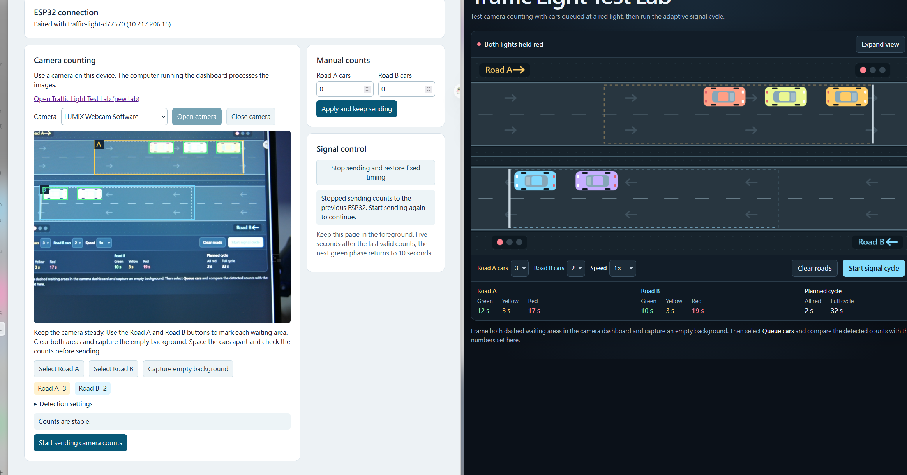
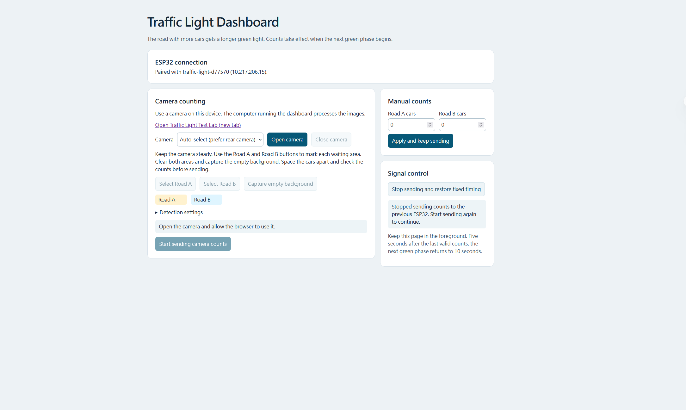
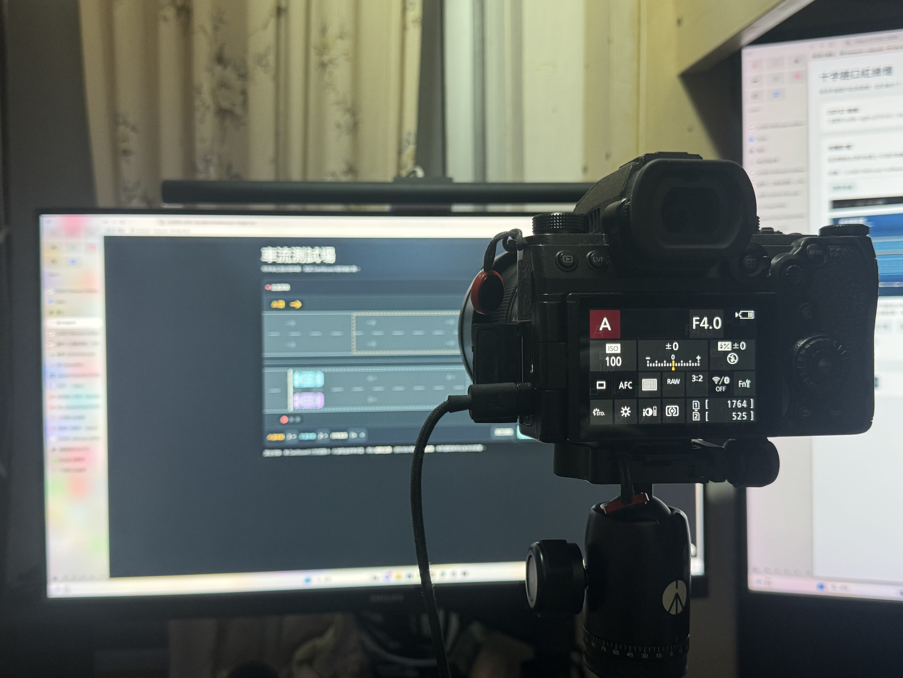
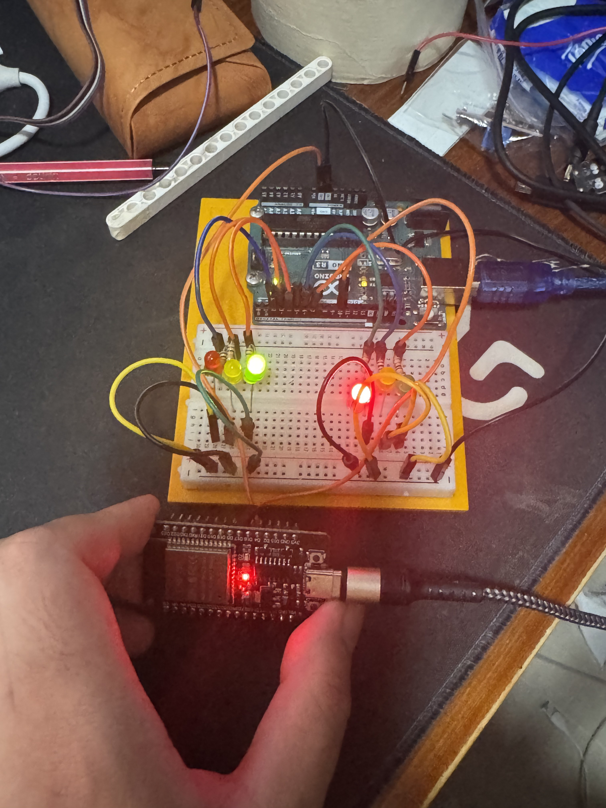

# INT4089 智慧交通號誌

[English](README.md) · **繁體中文**

這個課堂模型用 Arduino Uno R3 控制 A、B 兩條道路的六顆號誌 LED。電腦控制台透過鏡頭計算排隊車量，再由 ESP32 將車數送給 Uno。你也可以手動輸入車數。Uno 會為車輛較多的一道增加綠燈時間。

## 快速看示範



示範中，鏡頭對準螢幕上的車流測試場。完成校正後，控制台穩定辨識到 A 道 3 輛、B 道 2 輛。也可以把分開擺放的模型車放進兩道等候區。

## 下載瀏覽器相機控制台

Windows x64 使用 EXE 安裝程式。Linux 與 macOS 請選擇符合處理器的套件，再將整個壓縮檔解壓縮。各套件均包含 Python 與 OpenCV。 [GitHub Release v1.2.1](https://github.com/JacksonChan762/INT4089_traffic-light/releases/tag/v1.2.1)

| 平台 | 直接下載 | 啟動方法 |
| --- | --- | --- |
| Windows x64 安裝版 | [下載安裝程式 EXE](https://github.com/JacksonChan762/INT4089_traffic-light/releases/download/v1.2.1/TrafficLight-Camera-windows-x64-setup.exe) | 以一般 Windows 使用者帳戶執行安裝程式，完成後從開始功能表開啟 **Traffic Light Camera**。 |
| Linux x64 | [下載 tar.gz](https://github.com/JacksonChan762/INT4089_traffic-light/releases/download/v1.2.1/TrafficLight-Camera-linux-x64.tar.gz) | 在解壓後的資料夾開啟終端機，執行 `./start.sh`。 |
| Linux ARM64 | [下載 tar.gz](https://github.com/JacksonChan762/INT4089_traffic-light/releases/download/v1.2.1/TrafficLight-Camera-linux-arm64.tar.gz) | 在解壓後的資料夾開啟終端機，執行 `./start.sh`。 |
| macOS Apple Silicon | [下載 tar.gz](https://github.com/JacksonChan762/INT4089_traffic-light/releases/download/v1.2.1/TrafficLight-Camera-macos-apple-silicon.tar.gz) | 在解壓後的資料夾開啟 `Start.command`，或在終端機執行 `./Start.command`。 |
| macOS Intel | [下載 tar.gz](https://github.com/JacksonChan762/INT4089_traffic-light/releases/download/v1.2.1/TrafficLight-Camera-macos-intel.tar.gz) | 在解壓後的資料夾開啟 `Start.command`，或在終端機執行 `./Start.command`。 |

請用對應的 SHA-256 校驗碼驗證下載檔案。 [Windows 安裝程式校驗碼](https://github.com/JacksonChan762/INT4089_traffic-light/releases/download/v1.2.1/TrafficLight-Camera-windows-x64-setup.exe.sha256) · [Linux 與 macOS 套件校驗碼清單](https://github.com/JacksonChan762/INT4089_traffic-light/releases/download/v1.2.1/SHA256SUMS.txt)

## 快速開始

1. 依下方指示接線並燒錄 Uno 和 ESP32。將電腦接到提供 2.4 GHz Wi-Fi 的路由器。 [硬體與接線](#硬體與接線) · [編譯與燒錄](#編譯與燒錄)
2. 用 USB 將 ESP32 接到電腦，關閉序列監視器，再啟動套件。首次使用時，在提示輸入 `W`，讓 ESP32 加入同一台路由器。 [USB Wi-Fi 設定方式](browser_camera/README.zh-TW.md#加入電腦的網路)
3. ESP32 已設定後，在啟動程式按 Enter 開啟英文控制台，按 **Open camera** 並允許瀏覽器使用鏡頭。控制台找到一台 ESP32 時會自動配對。如果找到多台，請從 **Gateway** 選單選擇。
4. 鏡頭對準兩道等候區。按 **Select Road A** 和 **Select Road B** 分別畫框，清空兩道再按 **Capture empty background**。放回車輛後，等數字穩定再按 **Start sending camera counts**。也可以在 **Manual counts** 直接輸入數量。 [相機設定與校正指南](browser_camera/README.zh-TW.md#校正並傳送車輛數量)



如需使用 Android 或 iPhone 鏡頭，讓手機加入同一台路由器，並依指南設定受信任的 HTTPS 憑證。在電腦啟動程式輸入電腦的區域網路 IPv4 位址，再用手機開啟電腦的 HTTPS 網址。 [手機鏡頭設定](browser_camera/README.zh-TW.md#從手機瀏覽器使用鏡頭)



校正和測試期間，讓鏡頭與畫面保持固定。

## 硬體與接線

準備一塊 Arduino Uno R3、一塊可使用 GPIO16 和 GPIO17 的經典 ESP32-WROOM-32 開發板、兩條 USB 線、跳線、六顆低電流 LED（紅、黃、綠各兩顆）與六顆 1 kΩ 電阻。若使用 ESP32-C3、S3、WROVER 或 ESP32-CAM，請先確認該板的腳位與 PlatformIO 開發板設定。



照片為六顆 LED 與單向 UART 的接線示範。

接線前先切斷電源。每顆 LED 各用一顆 **1 kΩ 電阻**。將 Uno 對應腳位經電阻接到 LED 陽極（長腳），再將陰極接到 GND。以下接法適用於單顆低電流 LED。

| 道路 | 紅燈 | 黃燈 | 綠燈 |
| --- | --- | --- | --- |
| A（南北向） | D2 | D3 | D4 |
| B（東西向） | D5 | D6 | D7 |

| ESP32 | Uno | 用途 |
| --- | --- | --- |
| GPIO17（TX） | D10（RX） | 以 9600 baud 傳送控制指令 |
| GND | GND | 共地 |

兩塊板各由自己的 USB 線供電。將 5 V 與 3.3 V 電源線分開。只使用單向控制時，Uno D11 與 ESP32 GPIO16 保持未接。初步測試可用一條短跳線直接連接 GPIO17 與 D10。Uno 韌體會關閉 D10 的內部 5 V 上拉。

### 加入 UART 電平轉換器以查詢 Uno 狀態

使用支援 3.3 V 和 5 V 推挽 UART 訊號的非反相電平轉換器，且兩個通道能同時朝相反方向傳送。安裝前拔掉兩塊板的 USB 電源，並移除 GPIO17 直連 D10 的跳線。

| 來源 | 目的地 |
| --- | --- |
| ESP32 **3V3** | 轉換器低電壓側的電源腳位（部分模組標示為 `LV`） |
| Uno **5V** | 轉換器高電壓側的電源腳位（部分模組標示為 `HV`） |
| ESP32 GND 與 Uno GND | 轉換器 GND，三者接到同一個接地點 |
| ESP32 **GPIO17 TX** | 通道 1 的低電壓輸入端 |
| 通道 1 的高電壓輸出端 | Uno **D10 RX** |
| Uno **D11 TX** | 通道 2 的高電壓輸入端 |
| 通道 2 的低電壓輸出端 | ESP32 **GPIO16 RX** |

通電前先確認實際模組的腳位。如果模組有方向與啟用腳位，請依規格書將通道 1 設為從 3.3 V 傳向 5 V、通道 2 設為從 5 V 傳向 3.3 V，再啟用兩個通道。Uno D11 的回傳訊號須先經過電平轉換器，才可接到 ESP32 GPIO16。

## 編譯與燒錄

安裝 PlatformIO Core，或在 VS Code 安裝 PlatformIO IDE 擴充功能。首次編譯時需要透過網路下載工具鏈。開啟包含 `platformio.ini` 的專案資料夾，其中已分別定義 Uno 與 ESP32 的 Arduino 韌體環境。

在專案根目錄編譯兩個環境，並查看已連接的開發板序列埠。

```sh
pio run -e uno -e esp32
pio device list
```

先燒錄 Uno 韌體，確認 LED 能自行依序循環，再燒錄 ESP32 閘道韌體。將下列範例中的連接埠換成 `pio device list` 顯示的對應值。

```sh
pio run -e uno -t upload --upload-port /dev/cu.usbmodemXXXX
pio run -e esp32 -t upload --upload-port /dev/cu.usbserial-XXXX
```

Uno 韌體位於 [arduino_uno](arduino_uno)，號誌計時邏輯位於 [TrafficController.h](arduino_uno/TrafficController.h)。ESP32 以 Wi-Fi 用戶端模式加入與電腦相同的路由器，在區域網路上提供手動控制頁面，並將指令轉送給 Uno。 [ESP32 閘道韌體](esp32_gateway/esp32_gateway.cpp)

序列埠名稱因系統而異。Windows 使用實際分配的 COM 埠，Linux 使用實際的 `/dev/ttyUSB*` 或 `/dev/ttyACM*` 序列埠。

## 使用 ESP32 手動控制頁面

1. 為兩塊板供電。透過 USB 設定 ESP32 加入路由器的 2.4 GHz Wi-Fi，使用瀏覽器的裝置也要接入同一台路由器。 [USB Wi-Fi 設定方式](browser_camera/README.zh-TW.md#加入電腦的網路)
2. 在瀏覽器開啟 ESP32 從 USB 序列監視器顯示的 `http://` 網址。監視器使用 115200 baud。
3. 在 **Road A** 輸入 **8**，在 **Road B** 輸入 **3**，再按 **Apply and keep sending**。將頁面留在前景，以便每秒重新傳送數量。修改任一欄位後，再按一次相同的按鈕。
4. **Planned signal timing** 顯示預計的紅、黃、綠燈時間。此例中 A 道下一次綠燈為 **20 秒**，B 道則為 **10 秒**。傳送區會確認 ESP32 已收到指令。
5. 兩塊板都更新韌體並經由電平轉換器接線後，在 **Uno State** 按 **Check Uno state**。畫面顯示 Uno 最近回覆的燈號、本階段總時間與剩餘時間，以及下一次綠燈可用的有效車量或固定計時。頁面顯示時會定期查詢，按 **Stop checking Uno state** 即可停止。如果狀態無法取得，請檢查 Uno D11 到 ESP32 GPIO16 的回傳路徑，以及兩塊板是否共地。使用單向接線時，仍可在 Uno 的 USB 序列監視器以 115200 baud 查看燈號與時間。
6. 按 **Restore fixed timing** 恢復固定時間。關閉頁面或斷線後，Uno 會在最後一筆車量送達後五秒恢復固定時間。

## 號誌計時原理

Uno 啟動後，兩道紅燈先亮兩秒，之後重複 **A 綠燈 → A 黃燈 → 兩道紅燈 → B 綠燈 → B 黃燈 → 兩道紅燈**。黃燈固定三秒，兩道同時紅燈的間隔為兩秒。

每道綠燈的基本時間為 10 秒。如果某道車比另一道多，每多一輛就增加兩秒，最多以五輛計算。兩道車量相同時，各有 10 秒綠燈。Uno 在綠燈開始時決定該次時長，因此新收到的數量、過期的數量與固定時間指令會在下一次綠燈開始時生效。

## 驗證

在專案根目錄編譯並執行控制器測試。

```sh
c++ -std=c++11 -Wall -Wextra -pedantic tests/controller_test.cpp -o /tmp/traffic-controller-test
/tmp/traffic-controller-test
```

可依[瀏覽器相機測試說明](browser_camera/README.zh-TW.md#在各平台測試控制台)執行合成影像和 HTTP 測試。

實際接上模型時，先讓 Uno 單獨執行，確認固定週期。接著連上 ESP32，試著設定 A 道一輛、B 道四輛，B 道下一次綠燈應持續 16 秒。在綠燈亮起時更改車量，確認目前的燈號仍會跑完。關閉傳送介面，等五秒後確認下一次綠燈恢復為 10 秒。整個週期中，任何時刻最多只有一道亮綠燈。

## ESP32 HTTP API

瀏覽器控制台與 ESP32 手動頁面使用相同的 API。一次使用一個介面傳送數量，讓它送出的數量持續生效。兩個欄位都接受 0 到 99 的十進位整數。`ns` 對應 A 道，`ew` 對應 B 道。

```http
POST /api/counts
Content-Type: application/x-www-form-urlencoded

ns=8&ew=3
```

ESP32 會透過 UART 將此例以 `C,8,3\n` 傳給 Uno。傳送 `POST /api/auto` 可恢復固定時間，對應的序列指令為 `A\n`。兩個指令中的 `\n` 都代表換行。

使用 `GET /api/state` 可即時向 Uno 查詢。成功時會以 JSON 回傳 `available`、`phase`、`duration_ms`、`remaining_ms`、`counts_fresh`、`ns` 與 `ew`。燈號階段依循環順序以 0 至 5 表示，0 為 A 道轉綠燈前的全紅。當 `counts_fresh` 為真時，所回傳的車量有效，可用來計算下一次綠燈的時間。Uno 未傳回有效資料時，此端點回傳 HTTP 503。

## 參考資料

- [Espressif Wi-Fi API](https://docs.espressif.com/projects/arduino-esp32/en/latest/api/wifi.html)
- [Espressif WebServer 範例](https://github.com/espressif/arduino-esp32/blob/master/libraries/WebServer/examples/WebServer/WebServer.ino)
- [Arduino SoftwareSerial](https://docs.arduino.cc/learn/built-in-libraries/software-serial)
- [PlatformIO 原始檔篩選設定](https://docs.platformio.org/en/stable/projectconf/sections/env/options/build/build_src_filter.html)

## 授權

本專案的原始碼與文件採用 MIT 授權。套件內的第三方元件各自沿用原有授權。 [MIT 授權條款](LICENSE)
